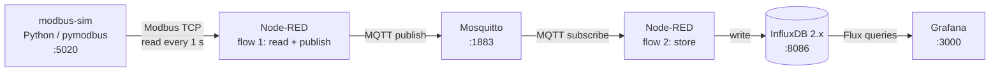

# Industrial Monitoring Pipeline

A small Industry 4.0 style monitoring pipeline. A simulated industrial machine exposes its data over **Modbus TCP**. **Node-RED** reads it every second and publishes JSON on **MQTT**. A second flow stores the readings in **InfluxDB**, and **Grafana** shows them live and raises an alert when the temperature goes above 75 °C. Everything runs with Docker Compose.


## Architecture



**Why two protocols?** Many industrial machines only speak Modbus (request/response, numbered registers). Modern IoT platforms use MQTT (publish/subscribe through a broker). Node-RED sits in the middle and translates, so the machine can stay as it is while any other tool can consume its data.

## Tech stack

| Component | Role |
|---|---|
| Python + pymodbus 3.6.9 | Simulated machine (Modbus TCP server) |
| Eclipse Mosquitto 2 | MQTT broker |
| Node-RED | Modbus read, JSON conversion, MQTT publish and subscribe, database write |
| InfluxDB 2.7 | Time-series storage |
| Grafana | Dashboard and alert rule |
| Docker Compose | One-command startup |

Node-RED palettes used: `node-red-contrib-modbus` and `node-red-contrib-influxdb`.

## Data model

**Modbus holding registers** (function code 3, unit id 1, port 5020):

| Address | Meaning | Encoding |
|---|---|---|
| 0 | Temperature | °C × 10 (652 = 65.2 °C) |
| 1 | Motor speed | rpm |
| 2 | Fault flag | 0 = OK, 1 = temperature above 75 °C |

**MQTT topic:** `factory/line1/machine1/telemetry`

**MQTT payload (JSON):**
```json
{"machine":"machine1","temperature":65.3,"rpm":1506,"fault":0,"ts_read":1793000000000}
```

**InfluxDB:** measurement `machine_telemetry`, tag `machine`, fields `temperature`, `rpm`, `fault` and `latency_ms`. `latency_ms` is the time between the Modbus read and the processing in the second flow (it does not include the database write or the dashboard refresh).

## Quick start

**Requirements:** Docker Desktop (with Docker Compose v2) and Git. About 8 GB of RAM is recommended.

```powershell
git clone https://github.com/Amen-Allah-Ben-Hamida/industrial-monitoring-pipeline.git
cd industrial-monitoring-pipeline
copy .env.example .env
```

Edit `.env` and set your own values (passwords need at least 8 characters, the token can be any long random string):

```
INFLUXDB_USERNAME=admin
INFLUXDB_PASSWORD=<your password>
INFLUXDB_ORG=lab
INFLUXDB_BUCKET=factory
INFLUXDB_TOKEN=<a long random token>
GRAFANA_ADMIN_PASSWORD=<your password>
```

Then start everything:

```powershell
docker compose up -d
docker compose ps
```

| Service | URL |
|---|---|
| Node-RED | http://localhost:1880 |
| InfluxDB | http://localhost:8086 |
| Grafana | http://localhost:3000 (user `admin`) |

All ports are published on `127.0.0.1` only.

### Setup notes

- **InfluxDB token in Node-RED.** Node-RED credentials are not stored in the repository. After the first start, open Node-RED, double-click the InfluxDB configuration node, paste the value of `INFLUXDB_TOKEN` from your `.env`, and click Deploy.
- **Node-RED palette.** If Node-RED reports missing node types, install `node-red-contrib-modbus` and `node-red-contrib-influxdb` from the palette manager.
- **InfluxDB credentials apply only on the first start.** InfluxDB creates the user, organization, bucket and token when its data volume is empty. If you change the values in `.env` afterwards, they will not take effect unless you recreate the volume (`docker compose down -v` deletes all stored data).
- **Grafana data source.** It is provisioned from `grafana/provisioning/datasources/influxdb.yml` using the values in `.env`, so it should work without manual setup. Check it under Connections, Data sources.

## Grafana dashboard and alert

Create a dashboard with one panel per field, using the InfluxDB data source in Flux mode. Example for the temperature panel:

```
from(bucket: "factory")
  |> range(start: v.timeRangeStart, stop: v.timeRangeStop)
  |> filter(fn: (r) => r._measurement == "machine_telemetry" and r._field == "temperature")
```

Use `"rpm"` and `"fault"` for the other two panels. Add a red threshold at 75 on the temperature panel.

**Alert rule** `High temperature machine1`: the same temperature query, condition *last value is above 75*, evaluated every 10 seconds with no pending period. The simulated temperature follows a slow wave between about 53 and 77 °C, so the alert fires roughly every three minutes and recovers on its own.


## Node-RED flows

- **Flow 1:** `modbus-read` (holding registers 0 to 2, every second) → function node that builds the JSON message → `mqtt out`.
- **Flow 2:** `mqtt in` (`factory/line1/+/telemetry`) → function node that computes `latency_ms` and formats fields and tags → `influxdb out`.

The flows are saved in `nodered/flows.json`.

## Project structure

```
industrial-monitoring-pipeline/
├── docker-compose.yml          # all services
├── .env.example                # template for secrets (the real .env is not committed)
├── mosquitto/
│   └── mosquitto.conf          # broker settings
├── simulator/
│   ├── simulator.py            # Modbus TCP server with 3 simulated registers
│   ├── check_client.py         # reads the registers once, to test the simulator
│   ├── requirements.txt
│   └── Dockerfile
├── nodered/
│   ├── flows.json              # both Node-RED flows
│   ├── package.json            # Node-RED palette dependencies
│   └── settings.js
├── grafana/
│   └── provisioning/datasources/influxdb.yml
└── docs/                       # project guide, decisions, troubleshooting, Git workflow
```

## Useful commands

```powershell
docker compose ps                                   # status of the services
docker compose logs <service> --tail 30             # recent logs
docker compose exec modbus-sim python check_client.py   # read the simulated registers
docker compose exec mosquitto mosquitto_sub -t "factory/#" -v   # watch MQTT messages
docker compose stop <service>                       # simulate a failure
docker compose start <service>
docker compose down                                 # stop everything, data is kept
```

Avoid `docker compose down -v`: it deletes the stored data (InfluxDB and Grafana volumes).

## Known limitations

- The Modbus device is simulated, not a real PLC or sensor.
- MQTT allows anonymous connections. This is acceptable only because every port is bound to `127.0.0.1`.
- MQTT uses QoS 0 and there is no buffering, so readings are lost while a downstream service is down.
- `latency_ms` measures the path from the Modbus read to the second Node-RED flow, not the database write or the dashboard display.
- The Grafana dashboard and alert rule are stored in Grafana's data volume, not in this repository.

## Possible improvements

- Replace the simulator with an ESP32 acting as a real Modbus TCP server with a DHT sensor.
- Add MQTT authentication.
- Add a second machine and filter by the `machine` tag.
- Provision the dashboard and alert rule from files.

## Documentation

The `docs/` folder contains the step-by-step project guide, the progress log, technical decisions, troubleshooting notes and the Git workflow used in this project.

## Author

Amenallah Ben Hamida, IoT engineering student, EPI Digital School, Sousse, Tunisia.
