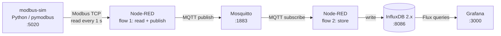

# PROJECT MASTER GUIDE — Industrial Monitoring Pipeline

**Guide status:** PART 1 of 2 written (Sections A–C, roadmap index, Phases 0–3). Part 2 (Phases 4–8) is NOT written yet.
**Single source of truth.** If you are an AI reading this with no prior context: read `PROGRESS.md` first (current state), then this file, then `DECISIONS.md`.

## Table of contents
- A. Project overview
- B. Prerequisites and environment
- C. Architecture and file structure
- D. Implementation roadmap (index + detailed steps)
  - Phase 0 — Accounts and tools (written)
  - Phase 1 — Repository setup (written)
  - Phase 2 — MQTT broker (written)
  - Phase 3 — Modbus simulator (written)
  - Phase 4 — Node-RED: Modbus to MQTT (**PART 2, not written**)
  - Phase 5 — InfluxDB storage (**PART 2, not written**)
  - Phase 6 — Grafana dashboard and alert (**PART 2, not written**)
  - Phase 7 — Testing, resilience, measurements (**PART 2, not written**)
  - Phase 8 — Final delivery (**PART 2, not written**)
- E. Testing strategy (summary here, detail in Part 2)
- Remaining sections list

**Step rules:** Step IDs are permanent (never renumber). Statuses: NOT STARTED, IN PROGRESS, BLOCKED, COMPLETED. A step is COMPLETED only when its completion criteria are verified. Update `PROGRESS.md` at every Git checkpoint.
**Shell convention:** every command is for **Windows PowerShell** (the terminal inside VS Code is fine) unless stated otherwise. `<username>` means your GitHub username.

---

# A. Project overview

**Purpose:** a small, reproducible industrial-monitoring pipeline that mimics how a factory machine is connected to a dashboard (Industry 4.0 pattern): a machine speaks **Modbus TCP**, a gateway converts it to **MQTT**, data is stored as a time series and displayed in **Grafana** with an alert.

**Intended users:** the author (learning + portfolio/CV), recruiters and engineers reading the GitHub repository.

**Problem solved:** most existing industrial equipment speaks Modbus, while modern IoT platforms use MQTT. This project demonstrates bridging the two, storing the data, and visualizing/alerting on it.

**Final result:** `docker compose up -d` starts the whole stack. Grafana shows live temperature, motor speed and fault status of a simulated machine, and an alert fires when temperature exceeds 75 °C. The GitHub repository has a README, an architecture diagram, screenshots and measured numbers.

### Mandatory requirements
| ID | Requirement |
|---|---|
| M1 | A simulated Modbus TCP device exposing temperature, speed and a fault flag |
| M2 | Node-RED reads the device cyclically (every 1 s) |
| M3 | Node-RED publishes readings to MQTT (Mosquitto) as JSON |
| M4 | A second Node-RED flow subscribes to MQTT and stores data in InfluxDB |
| M5 | Grafana dashboard: temperature, speed, fault state |
| M6 | A Grafana alert rule on temperature > 75 °C |
| M7 | Whole stack starts with one `docker compose up -d` |
| M8 | GitHub repo with README, diagram, screenshots, measured results |

### Optional enhancements (only after all mandatory items are COMPLETED)
O1 second simulated machine · O2 MQTT username/password · O3 automated tests with pytest · O4 Telegraf instead of the Node-RED store flow · O5 an OPC UA variant.

### Non-functional requirements
- **Reproducible:** a stranger can clone and run it following the README.
- **Secure basics:** no secrets in Git; services exposed only on `127.0.0.1`.
- **Light:** runs on a laptop with 8 GB RAM.
- **Measurable:** record number of values stored per minute and pipeline latency.

### Scope limits (be honest in README and on the CV)
Simulated device only (no real PLC). Local lab security (anonymous MQTT). Single machine unless O1 is done.

### Technology choices
| Tool | Why |
|---|---|
| Docker + Compose | One-command, reproducible environment; common in industry |
| Eclipse Mosquitto 2 | Standard lightweight MQTT broker |
| Python + pymodbus 3.6.9 | Simple way to simulate a Modbus TCP device (version pinned: the API changes between versions) |
| Node-RED + node-red-contrib-modbus | You already know Node-RED; Modbus nodes exist |
| InfluxDB 2.x | Time-series database built for sensor data |
| Grafana | Standard dashboards and alerting |
| Git + GitHub | Version control and public proof of work |

---

# B. Prerequisites and environment

| Tool | Needed for | Installed in | Verify with |
|---|---|---|---|
| GitHub account | hosting the repo | web | you can log in |
| Git for Windows | version control | P00-S02 | `git --version` |
| VS Code | editing files | P00-S03 | `code --version` |
| WSL 2 | backend required by Docker Desktop | P00-S04 | `wsl --status` |
| Docker Desktop | running all services | P00-S04 | `docker run hello-world` |

Python on your PC is **not required**: the simulator runs inside a container.
Hardware: 8 GB RAM minimum, ~10 GB free disk, CPU virtualization enabled in BIOS.
Ports used on your PC: 1883 (MQTT), 5020 (Modbus), 1880 (Node-RED), 8086 (InfluxDB), 3000 (Grafana). Make sure nothing else uses them.

---

# C. Architecture and file structure



**Data flow:** simulator updates 3 registers each second → Node-RED reads them → builds a JSON message → publishes on MQTT topic `factory/line1/machine1/telemetry` → second flow receives it, computes latency, writes to InfluxDB (measurement `machine_telemetry`) → Grafana queries InfluxDB.

**Modbus register map (holding registers, function code 3, unit id 1, port 5020):**
| Address | Meaning | Encoding |
|---|---|---|
| 0 | Temperature | °C × 10 (652 = 65.2 °C) |
| 1 | Motor speed | rpm (integer) |
| 2 | Fault flag | 0 = OK, 1 = temperature above 75 °C |

**MQTT message (JSON):** `{"machine":"machine1","temperature":65.2,"rpm":1503,"fault":0,"ts_read":1730000000000}`

**Target directory tree (grows during the project):**
```
industrial-monitoring-pipeline/
├── README.md                  # project front page (draft until Phase 8)
├── docker-compose.yml         # defines all services
├── .env.example               # template of secrets (committed)
├── .env                       # real secrets (NEVER committed)
├── .gitignore                 # files Git must ignore
├── .gitattributes             # forces LF line endings
├── docs/
│   ├── PROJECT_MASTER_GUIDE.md
│   ├── PROGRESS.md
│   ├── DECISIONS.md
│   ├── TROUBLESHOOTING.md
│   ├── GIT_GUIDE.md
│   └── screenshots/           # added in Phase 8
├── mosquitto/
│   └── mosquitto.conf         # broker settings (Phase 2)
├── simulator/                 # Phase 3
│   ├── simulator.py
│   ├── check_client.py
│   ├── requirements.txt
│   └── Dockerfile
├── nodered/                   # Phase 4 (flows.json, package.json, settings.js)
└── grafana/                   # Phase 6 (provisioning/datasources/influxdb.yml)
```

---

# D. Roadmap index

| Step ID | Title | Status | Written in |
|---|---|---|---|
| P00-S01 | Create GitHub account | NOT STARTED | Part 1 |
| P00-S02 | Install and configure Git | NOT STARTED | Part 1 |
| P00-S03 | Check VS Code and settings | NOT STARTED | Part 1 |
| P00-S04 | Enable WSL 2, install Docker Desktop | NOT STARTED | Part 1 |
| P00-S05 | Verify Docker | NOT STARTED | Part 1 |
| P01-S01 | Create project folder, `git init` | NOT STARTED | Part 1 |
| P01-S02 | Create `.gitignore`, `.gitattributes`, `.env.example` | NOT STARTED | Part 1 |
| P01-S03 | First commit | NOT STARTED | Part 1 |
| P01-S04 | Create GitHub repo and push | NOT STARTED | Part 1 |
| P02-S01 | Create branch `feature/mosquitto` | NOT STARTED | Part 1 |
| P02-S02 | Write broker config and compose file | NOT STARTED | Part 1 |
| P02-S03 | Start broker and test publish/subscribe | NOT STARTED | Part 1 |
| P02-S04 | Commit, push, Pull Request, merge | NOT STARTED | Part 1 |
| P03-S01 | Create branch `feature/modbus-simulator` | NOT STARTED | Part 1 |
| P03-S02 | Write the simulator files | NOT STARTED | Part 1 |
| P03-S03 | Add simulator to compose, build and run | NOT STARTED | Part 1 |
| P03-S04 | Verify with a Modbus client, commit, PR, merge | NOT STARTED | Part 1 |
| P04-S01 … | Node-RED: install Modbus nodes, read flow, publish to MQTT | NOT STARTED | **Part 2** |
| P05-S01 … | InfluxDB container, `.env`, store flow | NOT STARTED | **Part 2** |
| P06-S01 … | Grafana provisioning, dashboard, alert | NOT STARTED | **Part 2** |
| P07-S01 … | Tests, failure scenarios, measurements | NOT STARTED | **Part 2** |
| P08-S01 … | README, diagram, screenshots, cleanup, CV update | NOT STARTED | **Part 2** |

(Part 2 will fix the exact step IDs inside P04–P08; the phase prefixes are permanent.)

---

# PHASE 0 — Accounts and tools

## P00-S01 — Create a GitHub account
- **Objective:** have an online account to host your repository.
- **Why this matters:** GitHub is where recruiters will see the project.
- **Prerequisites:** an email address.
- **Concepts:** *Git* is a program on your PC that tracks file history. *GitHub* is a website that stores Git repositories online. They are different things.
- **Exact actions:**
  1. Go to https://github.com/signup and create the account. Choose a professional username (it appears on your CV).
  2. Verify your email.
  3. Enable two-factor authentication: Settings → Password and authentication.
  4. Settings → Emails → tick **Keep my email addresses private** and note the `...@users.noreply.github.com` address shown. You will use it in Git so your real email isn't public in commits.
- **Commands:** none.
- **Expected result:** you can log in and open your empty profile.
- **Verification:** log out and log back in; the noreply email is visible in Settings → Emails.
- **Common problems:** verification email missing → check spam, resend.
- **Completion criteria:** account works, 2FA on, noreply email noted.
- **Git checkpoint:** none.
- **Next step:** P00-S02.

## P00-S02 — Install and configure Git
- **Objective:** Git installed and identified with your name/email.
- **Why:** every commit records who made it.
- **Prerequisites:** P00-S01.
- **Concepts:** a *commit* is a saved snapshot of your project with a message. `git config --global` stores settings for your whole PC user.
- **Exact actions:**
  1. Download Git for Windows from https://git-scm.com/download/win and run the installer.
  2. Key installer choices: default editor → **Visual Studio Code**; initial branch name → **Override: main**; PATH → **Git from the command line and also from 3rd-party software**; line endings → default (**Checkout Windows-style, commit Unix-style**); credential helper → **Git Credential Manager** (default). Keep other defaults.
  3. Open a **new** PowerShell window.
- **Commands (any directory):**
  ```powershell
  git --version
  git config --global user.name "Your Name"
  git config --global user.email "<your-noreply-email-from-GitHub>"
  git config --global init.defaultBranch main
  git config --global --list
  ```
  *What they do:* show the version; set the name and email stored in each commit; make new repos start on `main`; list your settings.
- **Expected result:** a version like `git version 2.x.x.windows.x` and your settings in the list.
- **Verification:** `git config --global user.email` prints the noreply address.
- **Common problems:** `git` not recognized → close and reopen PowerShell; if it persists, rerun the installer and choose the PATH option above.
- **Completion criteria:** version prints and name/email/defaultBranch are set.
- **Git checkpoint:** none.
- **Next step:** P00-S03.

## P00-S03 — Check VS Code and settings
- **Objective:** a working editor with useful extensions and LF line endings.
- **Why:** Linux containers expect LF line endings; Windows files may default to CRLF and break config files.
- **Prerequisites:** P00-S02.
- **Exact actions:**
  1. Run `code --version`. If missing, install from https://code.visualstudio.com (tick "Add to PATH").
  2. Extensions (Ctrl+Shift+X): **Docker** (ms-azuretools.vscode-docker) and **YAML** (redhat.vscode-yaml).
  3. File → Preferences → Settings, search `files.eol`, set it to `\n`.
- **Commands:** `code --version`
- **Expected result:** a version number; extensions listed as installed.
- **Verification:** open any new file; the status bar bottom-right shows **LF**.
- **Common problems:** `code` not recognized → reinstall with PATH option, or use Start menu.
- **Completion criteria:** VS Code opens, both extensions installed, LF set.
- **Git checkpoint:** none.
- **Next step:** P00-S04.

## P00-S04 — Enable WSL 2 and install Docker Desktop
- **Objective:** Docker running on Windows.
- **Why:** every service in this project runs as a container.
- **Prerequisites:** admin rights, ~10 GB free disk, virtualization enabled.
- **Concepts:** a *container* is an isolated, lightweight environment that runs a program with all its dependencies. *Docker Compose* starts several containers from one file. *WSL 2* is the Linux layer Docker Desktop uses on Windows.
- **Exact actions:**
  1. Check virtualization: Task Manager → Performance → CPU → **Virtualization: Enabled**. If Disabled, enable it in BIOS (names: Intel VT-x / AMD SVM), then continue.
  2. Open PowerShell **as Administrator** and run the command below, then restart the PC.
  3. Download Docker Desktop from https://www.docker.com/products/docker-desktop/ and install, keeping **Use WSL 2 instead of Hyper-V** ticked. (Free for personal and educational use; read the licence terms.)
  4. Start Docker Desktop and wait until it says the engine is running.
- **Commands (PowerShell as Administrator):**
  ```powershell
  wsl --install
  ```
  After restart (normal PowerShell):
  ```powershell
  wsl --status
  ```
- **Expected result:** WSL default version 2; Docker Desktop shows "Engine running".
- **Verification:** next step.
- **Common problems:**
  - "Virtualization must be enabled" → BIOS setting above.
  - "WSL 2 installation is incomplete" → run `wsl --update` and restart.
  - Docker stuck on "starting" → quit Docker Desktop, run `wsl --shutdown`, start it again.
- **Completion criteria:** Docker Desktop engine running.
- **Git checkpoint:** none.
- **Next step:** P00-S05.

## P00-S05 — Verify Docker
- **Objective:** prove Docker and Compose work.
- **Prerequisites:** P00-S04.
- **Commands (any directory):**
  ```powershell
  docker --version
  docker compose version
  docker run hello-world
  ```
- **Expected result:** versions print; the last command prints "Hello from Docker!".
- **Verification:** the three commands succeed without errors.
- **Common problems:** "cannot connect to the Docker daemon" → Docker Desktop isn't running; start it and wait.
- **Completion criteria:** `hello-world` runs.
- **Git checkpoint:** none.
- **Next step:** P01-S01. **Update `PROGRESS.md` later, once the repo exists.**

---

# PHASE 1 — Repository setup

## P01-S01 — Create the project folder and initialize Git
- **Objective:** a local folder tracked by Git.
- **Why:** Git history starts here; you can always go back.
- **Prerequisites:** Phase 0 completed.
- **Concepts:** *repository* = project folder + its history (hidden `.git` folder). *Working directory* = your files as you see them.
- **Exact actions:**
  1. Create the folder **outside OneDrive** (OneDrive sync can corrupt Git folders).
  2. Copy the downloaded guide files into `docs\` (`PROJECT_MASTER_GUIDE.md`, `PROGRESS.md`, `DECISIONS.md`, `TROUBLESHOOTING.md`, `GIT_GUIDE.md`). Put `README.md` in the project root.
- **Commands:**
  ```powershell
  mkdir $HOME\projects
  cd $HOME\projects
  mkdir industrial-monitoring-pipeline
  cd industrial-monitoring-pipeline
  mkdir docs
  git init
  git status
  code .
  ```
  *What they do:* create folders, turn the folder into a repository, show its state, open it in VS Code.
- **Expected result:** `Initialized empty Git repository` and `git status` listing untracked files after you copy the guide files.
- **Verification:** `Get-ChildItem -Force` shows a `.git` folder.
- **Common problems:** `fatal: not a git repository` → you are in the wrong folder; `cd` into the project.
- **Completion criteria:** `.git` exists; guide files are in place.
- **Git checkpoint:** wait for P01-S03.
- **Next step:** P01-S02.

## P01-S02 — Create `.gitignore`, `.gitattributes`, `.env.example`
- **Objective:** keep secrets and junk out of Git and force LF line endings.
- **Why:** secrets pushed to GitHub are public forever; CRLF can break files read by Linux containers.
- **Prerequisites:** P01-S01.
- **Concepts:** `.gitignore` lists files Git must never track. `.env` holds secrets; `.env.example` is the safe template that IS committed.
- **Code changes (create 3 new files in the project root, in VS Code):**

`.gitignore`
```
# Secrets
.env

# Node-RED runtime data (keep flows.json, package.json, settings.js)
nodered/node_modules/
nodered/.npm/
nodered/.config.*.json
nodered/flows_cred.json
nodered/*.backup
nodered/.*.backup
nodered/context/
nodered/lib/

# OS / editor
.DS_Store
Thumbs.db
.vscode/

# Python
__pycache__/
*.pyc
.venv/
```

`.gitattributes`
```
* text=auto eol=lf
```

`.env.example`
```
INFLUXDB_USERNAME=admin
INFLUXDB_PASSWORD=change-me-please-123
INFLUXDB_ORG=lab
INFLUXDB_BUCKET=factory
INFLUXDB_TOKEN=change-me-to-a-long-random-token
```
- **Code explanation:** `.gitignore` patterns are paths; the `nodered/...` lines will matter in Phase 4. `text=auto eol=lf` tells Git to store text files with LF. The `.env.example` values are placeholders; you create the real `.env` in Phase 5.
- **Expected result:** three new files visible in VS Code.
- **Verification:** `git status` lists the three files (and not `.env`, which doesn't exist yet).
- **Common problems:** Windows hides file extensions or adds `.txt` → in VS Code use File → New File and type the exact name; check with `Get-ChildItem -Force`.
- **Completion criteria:** all three files exist with the exact content.
- **Git checkpoint:** next step.
- **Next step:** P01-S03.

## P01-S03 — First commit
- **Objective:** save the first snapshot.
- **Why:** commits are your safety net and your visible work history.
- **Prerequisites:** P01-S02.
- **Concepts:** the *staging area* is a waiting room: `git add` puts changes there, `git commit` saves them as a snapshot. Good commit messages start with a type: `feat:` (new feature), `fix:`, `docs:`, `chore:`.
- **Commands (inside the project folder):**
  ```powershell
  git status
  git add .
  git status
  git commit -m "chore: initial project docs and git configuration"
  git log --oneline
  ```
  *What they do:* check state, stage everything, check again (files turn green), save the snapshot, list history.
- **Expected result:** one commit in `git log --oneline`.
- **Verification:** `git status` says `nothing to commit, working tree clean`.
- **Common problems:** `Author identity unknown` → redo the `git config` commands from P00-S02. LF/CRLF warnings are harmless.
- **Completion criteria:** clean working tree, one commit.
- **Git checkpoint:** done (local only). Update `docs/PROGRESS.md` (mark P00 and P01-S01..S03 COMPLETED) — you will commit that at the next checkpoint.
- **Next step:** P01-S04.

## P01-S04 — Create the GitHub repository and push
- **Objective:** put your repo online.
- **Why:** backup, portfolio, and the base for Pull Requests.
- **Prerequisites:** P01-S03.
- **Concepts:** a *remote* is a copy of the repo on another machine. `origin` is the usual name of your GitHub remote. `push` uploads commits.
- **Exact actions:**
  1. On GitHub: **New repository** → name `industrial-monitoring-pipeline` → **Public** → do NOT tick README, .gitignore or licence (the repo must be empty) → Create.
  2. Run the commands below. A browser window opens once to sign in (Git Credential Manager).
- **Commands:**
  ```powershell
  git remote add origin https://github.com/<username>/industrial-monitoring-pipeline.git
  git branch -M main
  git push -u origin main
  git ls-files
  ```
  *What they do:* link the remote, make sure the branch is called `main`, upload and remember the link (`-u`), list tracked files.
- **Expected result:** files appear on your GitHub repo page.
- **Verification:** `git ls-files` shows `.env.example` but NOT `.env`; the GitHub page shows `docs/` and the three config files.
- **Common problems:** `remote origin already exists` → `git remote -v` to inspect, then `git remote set-url origin <url>`; `src refspec main does not match any` → no commit yet, redo P01-S03; auth failure → Windows "Credential Manager" → remove `git:https://github.com` entries and retry.
- **Completion criteria:** repo visible on GitHub with your files.
- **Git checkpoint:** done.
- **Next step:** P02-S01.

---

# PHASE 2 — MQTT broker

## P02-S01 — Create the branch `feature/mosquitto`
- **Objective:** work on a separate line of history.
- **Why:** `main` stays always-working; experiments happen on branches and are merged when verified.
- **Prerequisites:** P01-S04.
- **Concepts:** a *branch* is an independent line of commits. `git switch -c name` creates and moves to it.
- **Commands:**
  ```powershell
  git switch -c feature/mosquitto
  git branch
  ```
- **Expected result:** `* feature/mosquitto` in the list.
- **Verification:** `git status` first line says `On branch feature/mosquitto`.
- **Common problems:** `fatal: a branch named ... already exists` → use `git switch feature/mosquitto`.
- **Completion criteria:** you are on the new branch.
- **Git checkpoint:** none yet.
- **Next step:** P02-S02.

## P02-S02 — Write the broker config and the compose file
- **Objective:** define the Mosquitto service.
- **Why:** MQTT is the backbone: Node-RED publishes to it and subscribes from it.
- **Prerequisites:** P02-S01.
- **Concepts:** *MQTT* is a publish/subscribe messaging protocol: clients publish messages to a *topic* and others subscribe to it; the *broker* routes them. `docker-compose.yml` describes services; YAML uses spaces for indentation (never tabs).
- **Code changes (create 2 new files):**

`mosquitto/mosquitto.conf`
```
listener 1883
allow_anonymous true
log_dest stdout
```

`docker-compose.yml`
```yaml
name: industrial-monitoring-pipeline

services:
  mosquitto:
    image: eclipse-mosquitto:2
    container_name: mosquitto
    ports:
      - "127.0.0.1:1883:1883"
    volumes:
      - ./mosquitto/mosquitto.conf:/mosquitto/config/mosquitto.conf:ro
    restart: unless-stopped
```
- **Code explanation:** Mosquitto 2 refuses outside connections unless a `listener` is declared, hence `listener 1883`. `allow_anonymous true` is acceptable ONLY because the port is bound to `127.0.0.1` (your PC only); see `DECISIONS.md` D-006. The volume mounts your config read-only into the container.
- **Expected result:** two new files.
- **Verification:** `docker compose config` prints the file without errors.
- **Common problems:** YAML error "mapping values not allowed" → indentation; use 2 spaces.
- **Completion criteria:** `docker compose config` succeeds.
- **Git checkpoint:** next steps.
- **Next step:** P02-S03.

## P02-S03 — Start the broker and test publish/subscribe
- **Objective:** prove messages flow through Mosquitto.
- **Prerequisites:** P02-S02, Docker Desktop running.
- **Commands (project folder, terminal 1):**
  ```powershell
  docker compose up -d
  docker compose ps
  docker compose logs mosquitto
  docker compose exec mosquitto mosquitto_sub -t "test/#" -v
  ```
  *What they do:* start in background, list containers, show logs, listen to all topics under `test/` (this command keeps running).
  **Terminal 2** (open a second terminal in the same folder):
  ```powershell
  docker compose exec mosquitto mosquitto_pub -t "test/hello" -m "hi from terminal 2"
  ```
- **Expected result:** terminal 1 prints `test/hello hi from terminal 2`. Logs show `Opening ipv4 listen socket on port 1883`.
- **Verification:** the message appears. Stop the subscriber with Ctrl+C.
- **Common problems:** `port is already allocated` → another program uses 1883; stop it or change the left port to `1884` in compose; image pull fails → check internet.
- **Completion criteria:** a message published in one terminal is received in the other.
- **Git checkpoint:** next step.
- **Next step:** P02-S04.

## P02-S04 — Commit, push, Pull Request, merge
- **Objective:** deliver the verified feature into `main` the standard way.
- **Why:** PRs are how teams review and merge work; employers expect to see this workflow.
- **Prerequisites:** P02-S03 verified.
- **Concepts:** `git diff` shows unstaged changes. A *Pull Request* (PR) is a GitHub request to merge a branch into `main`. A *merge* combines histories.
- **Exact actions:** update `docs/PROGRESS.md` (mark P02 steps COMPLETED, set next step P03-S01), then:
  ```powershell
  git status
  git diff
  git add .
  git commit -m "feat: add Mosquitto broker service with compose"
  git push -u origin feature/mosquitto
  ```
  Then on GitHub: click **Compare & pull request** → **Create pull request** → read the "Files changed" tab → **Merge pull request** → **Confirm merge** → **Delete branch**. Back in PowerShell:
  ```powershell
  git switch main
  git pull
  git branch -d feature/mosquitto
  git log --oneline
  ```
  *What they do:* switch to `main`, download the merged result, delete the finished local branch, show history.
- **Expected result:** `main` contains the Mosquitto files; the PR shows as Merged.
- **Verification:** `git log --oneline` lists the feat commit (and a merge commit); `docker-compose.yml` exists on `main`.
- **Common problems:** `git branch -d` refuses ("not fully merged") → you haven't pulled the merge yet; run `git pull` first. Do NOT use `-D` as a shortcut.
- **Completion criteria:** feature merged, you are on `main`, clean working tree.
- **Git checkpoint:** done.
- **Next step:** P03-S01.

---

# PHASE 3 — Modbus simulator

## P03-S01 — Create the branch `feature/modbus-simulator`
- **Objective/Why:** same pattern as P02-S01.
- **Prerequisites:** P02-S04 completed, you are on updated `main`.
- **Commands:**
  ```powershell
  git switch main
  git pull
  git switch -c feature/modbus-simulator
  ```
- **Verification:** `git branch` shows `* feature/modbus-simulator`.
- **Completion criteria:** on the new branch. **Git checkpoint:** none. **Next step:** P03-S02.

## P03-S02 — Write the simulator files
- **Objective:** a program that behaves like an industrial machine over Modbus TCP.
- **Why:** you have no PLC; the simulator provides realistic data and a periodic fault.
- **Prerequisites:** P03-S01.
- **Concepts:** *Modbus TCP* is a request/response protocol where a client reads numbered 16-bit *holding registers* from a server (the device). Our map is in Section C. Temperature is stored ×10 because registers hold integers only.
- **Code changes (create 4 files in `simulator/`):**

`simulator/requirements.txt`
```
pymodbus==3.6.9
```

`simulator/simulator.py`
```python
"""Simulated industrial machine exposed over Modbus TCP.

Holding registers (function code 3):
  0 -> temperature x10 (652 = 65.2 C)
  1 -> motor speed in rpm
  2 -> fault flag (0 = OK, 1 = temperature above 75 C)
"""
import asyncio
import logging
import math
import random

from pymodbus.datastore import (
    ModbusSequentialDataBlock,
    ModbusServerContext,
    ModbusSlaveContext,
)
from pymodbus.server import StartAsyncTcpServer

HOST = "0.0.0.0"
PORT = 5020
FAULT_TEMP_C = 75.0

logging.basicConfig(level=logging.INFO, format="%(asctime)s %(levelname)s %(message)s")
log = logging.getLogger("simulator")


async def update_registers(context):
    """Update the three registers once per second."""
    t = 0
    while True:
        temperature = 65 + 12 * math.sin(t / 30) + random.uniform(-0.5, 0.5)
        rpm = int(1500 + 100 * math.sin(t / 10) + random.randint(-10, 10))
        fault = 1 if temperature > FAULT_TEMP_C else 0
        context[0].setValues(3, 0, [int(temperature * 10), rpm, fault])
        if t % 10 == 0:
            log.info("temp=%.1f C rpm=%d fault=%d", temperature, rpm, fault)
        t += 1
        await asyncio.sleep(1)


async def main():
    store = ModbusSlaveContext(
        hr=ModbusSequentialDataBlock(0, [0] * 10), zero_mode=True
    )
    context = ModbusServerContext(slaves=store, single=True)
    updater = asyncio.create_task(update_registers(context))
    log.info("Modbus TCP server listening on %s:%d", HOST, PORT)
    await StartAsyncTcpServer(context=context, address=(HOST, PORT))
    await updater


if __name__ == "__main__":
    asyncio.run(main())
```

`simulator/check_client.py`
```python
"""Reads the 3 registers once, to check that the simulator answers."""
from pymodbus.client import ModbusTcpClient

client = ModbusTcpClient("localhost", port=5020)
if not client.connect():
    raise SystemExit("Could not connect to the Modbus server")

result = client.read_holding_registers(0, 3, slave=1)
if result.isError():
    raise SystemExit(f"Modbus error: {result}")

temp10, rpm, fault = result.registers
print(f"temperature={temp10 / 10:.1f} C, rpm={rpm}, fault={fault}")
client.close()
```

`simulator/Dockerfile`
```dockerfile
FROM python:3.12-slim
ENV PYTHONUNBUFFERED=1
WORKDIR /app
COPY requirements.txt .
RUN pip install --no-cache-dir -r requirements.txt
COPY simulator.py check_client.py ./
CMD ["python", "simulator.py"]
```
- **Code explanation:**
  - `ModbusSequentialDataBlock(0, [0]*10)`: a block of 10 registers starting at address 0. `zero_mode=True` makes address 0 mean register 0 (without it the library shifts addresses by 1).
  - `update_registers`: every second it computes temperature (a slow sine wave 53–77 °C plus noise, so it crosses 75 °C periodically), speed, and the fault flag, then writes the 3 values with `setValues(3, 0, [...])` (3 = holding registers, 0 = start address).
  - `StartAsyncTcpServer` answers client reads on port 5020 (not 502, which needs admin rights on Linux).
  - The updater runs as a background task while the server runs.
  - `PYTHONUNBUFFERED=1` makes logs appear immediately in `docker compose logs`.
- **Expected result:** four files in `simulator/`.
- **Verification:** `Get-ChildItem simulator` lists them.
- **Common problems:** `requirements.txt` saved as UTF-16 by Notepad → create files in VS Code (UTF-8).
- **Completion criteria:** all four files exist with the exact content.
- **Git checkpoint:** after P03-S04.
- **Next step:** P03-S03.

## P03-S03 — Add the simulator to compose, build and run
- **Objective:** run the simulator as a container next to Mosquitto.
- **Prerequisites:** P03-S02.
- **Code changes:** **replace the whole content** of `docker-compose.yml` with:
```yaml
name: industrial-monitoring-pipeline

services:
  mosquitto:
    image: eclipse-mosquitto:2
    container_name: mosquitto
    ports:
      - "127.0.0.1:1883:1883"
    volumes:
      - ./mosquitto/mosquitto.conf:/mosquitto/config/mosquitto.conf:ro
    restart: unless-stopped

  modbus-sim:
    build: ./simulator
    container_name: modbus-sim
    ports:
      - "127.0.0.1:5020:5020"
    restart: unless-stopped
```
- **Commands:**
  ```powershell
  docker compose up -d --build
  docker compose ps
  docker compose logs modbus-sim
  ```
  *What they do:* build the simulator image and start both services; list them; show the simulator's output.
- **Expected result:** both services `running`; logs show `Modbus TCP server listening on 0.0.0.0:5020` and a `temp=... rpm=... fault=...` line every 10 s.
- **Verification:** `docker compose ps` shows `mosquitto` and `modbus-sim` as running (not restarting).
- **Common problems:** container keeps restarting → read `docker compose logs modbus-sim`; an `ImportError` means the pymodbus version differs from the pinned one (check `requirements.txt`).
- **Completion criteria:** both containers stay running for 1 minute.
- **Git checkpoint:** after P03-S04.
- **Next step:** P03-S04.

## P03-S04 — Verify with a Modbus client, commit, PR, merge
- **Objective:** prove a Modbus client can read the registers, then deliver the feature.
- **Prerequisites:** P03-S03.
- **Commands (verification):**
  ```powershell
  docker compose exec modbus-sim python check_client.py
  ```
  Run it 3 times, 5+ seconds apart.
- **Expected result:** lines like `temperature=64.8 C, rpm=1512, fault=0`, with values changing between runs.
- **Verification:** values change; `fault=1` appears when temperature exceeds 75.0 (wait up to ~3 minutes by repeating; this happens around the peak of the wave).
- **Common problems:** `Could not connect` → server not ready (wait 5 s) or container crashed (check logs).
- **Completion criteria:** three successful reads with different values.
- **Git checkpoint:** update `docs/PROGRESS.md` (P03 COMPLETED, next step P04-S01 "Part 2 not written yet"), then:
  ```powershell
  git status
  git add .
  git commit -m "feat: add Modbus TCP machine simulator"
  git push -u origin feature/modbus-simulator
  ```
  On GitHub: Create pull request → Merge → Delete branch. Then:
  ```powershell
  git switch main
  git pull
  git branch -d feature/modbus-simulator
  ```
- **Next step:** P04-S01 (**Part 2**). Ask your AI for "Part 2 of PROJECT_MASTER_GUIDE.md" and give it the files in `docs/`.

---

# E. Testing strategy (summary; detail in Part 2)
Every phase has a verification step before merge (Phases 0–3 above are manual checks). Part 2 adds an end-to-end test (Modbus → MQTT → InfluxDB → Grafana), failure scenarios (stop the simulator, stop the broker), a values-per-minute query and a latency measurement.

# Remaining sections to write (Part 2)
- Phases 4–8 in full step template.
- Section G expansion: troubleshooting for Node-RED, InfluxDB, Grafana.
- Section H: final delivery checklist, README, screenshots, CV update.
- Container version pinning (record exact versions in `DECISIONS.md`).
